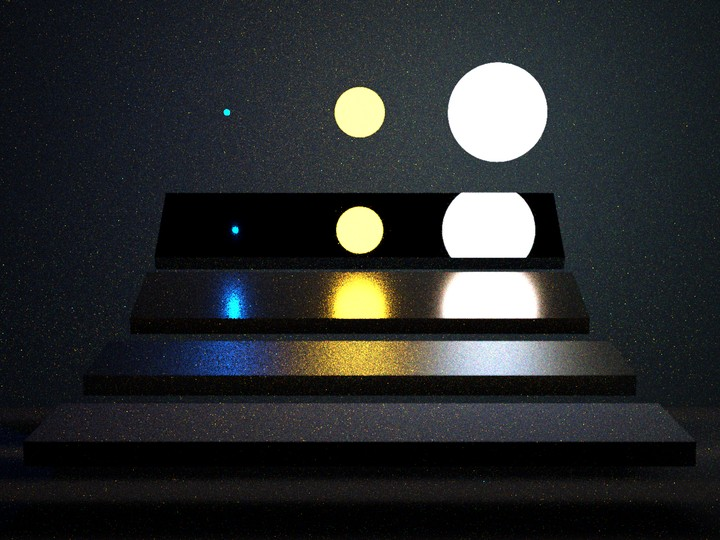
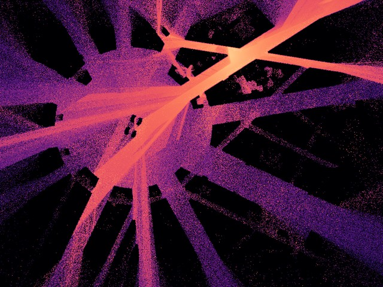
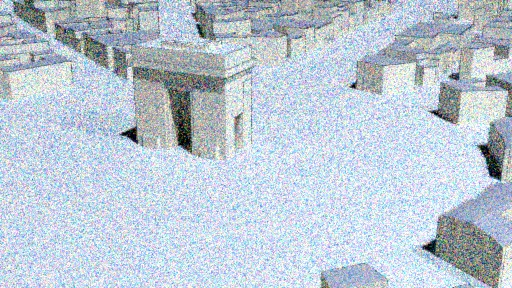
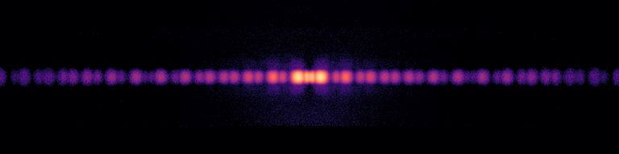

Gallery
=======================================

Scenes rendered on the GPU (an NVIDIA GB10, CUDA + OptiX build), with their render times, as the command line reports them (``Elapsed``).
The images are the renders' tonemapped outputs, downscaled for this page, unless noted.
To render one, run, from the repository's root:

.. code-block:: sh

   ./wave_tracer render --gpu [--ray-tracing] <scene> -D res=<res> -D spp=<spp> -o out

Scenes of ``scenes/``
---------------------

.. list-table::
   :header-rows: 1
   :widths: 30 22 22 13 13

   * - Scene
     - Integrator, mode
     - Film
     - Samples
     - Time
   * - ``veach_mis/mis.xml``
     - backward ``plt_path``, beams
     - 1440×1080, RGB
     - 128
     - 10.1 s
   * - ``sionna_etoile/etoile.xml``
     - forward ``plt_path``, beams
     - 1024×768 coverage, 1 GHz
     - 512
     - 32.7 s
   * - ``sionna_etoile/etoile.xml`` ``-D optical_preview=true``
     - backward ``plt_path``, beams
     - 512×288, RGB
     - 64
     - 1.13 s
   * - ``sionna_munich/munich.xml``
     - forward ``plt_path``, beams
     - 960×633 coverage, 1 GHz
     - 128
     - 18.8 s
   * - ``diffraction_simple/double_slits.xml``
     - forward ``plt_path``, beams
     - 1024×256, 50 µm
     - 32
     - 1.75 s
   * - ``cornell-box/box.xml``
     - ``plt_bdpt``, rays
     - 512×512, RGB
     - 256
     - 5.77 s
   * - ``cornell-box/box.xml``
     - ``plt_bdpt``, beams
     - 256×256, RGB
     - 64
     - 77.2 s
   * - ``cornell-box/sphere_polarization.xml``
     - ``plt_bdpt``, rays
     - 384×384, Stokes
     - 256
     - 4.44 s
   * - ``cornell-box/sphere_polarization.xml``
     - ``plt_bdpt``, beams
     - 192×192, Stokes
     - 16
     - 31.4 s
   * - ``colourchecker/colourchecker.xml``
     - backward ``plt_path``, beams
     - 192×144, Stokes
     - 4
     - 22.7 s
   * - ``bidir_room/room.xml``
     - ``plt_bdpt``, beams
     - 192×109, RGB
     - 4
     - 22.3 s

   ``veach_mis``: 1440×1080, 128 samples per pixel, beams, 10.1 s.

   ``sionna_etoile``: a 1 GHz coverage map (dB) of an 840 m wide area, 1024×768, 512 samples per element, beams, 32.7 s.

   ``sionna_etoile``, its optical preview: 512×288, 64 samples per pixel, beams, 1.13 s.

   ``diffraction_simple/double_slits``: the interference pattern (dB) of a double slit, 1024×256, 32 samples per element, beams, 1.75 s.

.. grid:: 1 2 3 3
   :gutter: 2

   .. grid-item-card:: ``cornell-box/box.xml``, ray tracing
      :img-top: ../_static/gpu/cornell_box_rt.jpg

      ``plt_bdpt``, 512×512, 256 samples per pixel: 5.77 s.

   .. grid-item-card:: ``sphere_polarization``, ray tracing
      :img-top: ../_static/gpu/sphere_polarization_rt.jpg

      ``plt_bdpt``, polarimetric (intensity shown), 384×384, 256 samples per pixel: 4.44 s.

   .. grid-item-card:: ``sphere_polarization``, beams
      :img-top: ../_static/gpu/sphere_polarization_beams.jpg

      ``plt_bdpt`` with beams, 192×192, 16 samples per pixel: 31.4 s. Beams make ``plt_bdpt`` paths hundreds of times costlier (see :doc:`performance`).

Test scenes
-----------

The test scenes of the `Rust bindings <https://github.com/toastertaster/wave_tracers>`_ (``tests/scenes``), whose tests compare GPU and CPU renders, each exercising features the GPU renders.
All at 256×256 and 256 samples per pixel, with beams.
The box scenes are shown with an exposure of their own (scaled to a log-average luminance of 0.18, then sRGB-encoded), as their default tonemapping saturates; the coverage maps with their own tonemapping (dB).

.. grid:: 2 3 5 5
   :gutter: 2

   .. grid-item-card:: ``box``
      :img-top: ../_static/gpu/test_box.jpg

      Diffuse Cornell box, area light. 1.52 s

   .. grid-item-card:: ``lights_box``
      :img-top: ../_static/gpu/test_lights_box.jpg

      Point, spot, directional and area emitters. 1.08 s

   .. grid-item-card:: ``glass_box``
      :img-top: ../_static/gpu/test_glass_box.jpg

      Dielectrics: BK7 glass, tinted water. 1.67 s

   .. grid-item-card:: ``textured_box``
      :img-top: ../_static/gpu/test_textured_box.jpg

      Bitmap textures, normal map. 1.07 s

   .. grid-item-card:: ``rough_box``
      :img-top: ../_static/gpu/test_rough_box.jpg

      Rough fractal and gaussian surfaces. 1.29 s

   .. grid-item-card:: ``rgb_box``
      :img-top: ../_static/gpu/test_rgb_box.jpg

      Coloured walls, aluminium mirror, blackbody light. 1.06 s

   .. grid-item-card:: ``polarized_box``
      :img-top: ../_static/gpu/test_polarized_box.jpg

      Polarimetric camera (intensity shown, at a log-average of 0.09). 1.01 s

   .. grid-item-card:: ``coverage``
      :img-top: ../_static/gpu/test_coverage.jpg

      Forward coverage at 1 GHz. 0.49 s

   .. grid-item-card:: ``lights_coverage``
      :img-top: ../_static/gpu/test_lights_coverage.jpg

      Coverage of every emitter type. 0.68 s

   .. grid-item-card:: ``two_band_coverage``
      :img-top: ../_static/gpu/test_two_band_coverage.jpg

      Coverage at 1 GHz and 2.4 GHz. 0.51 s
