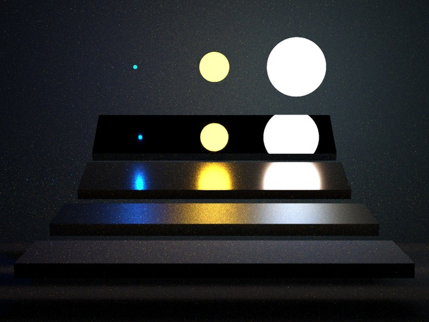

GPU rendering
=======================================

**wave_tracer** can render on an NVIDIA GPU, with CUDA and, optionally, OptiX; or, on macOS, on an Apple silicon GPU (M1 or later), with Metal.
GPU rendering supports a subset of the scene elements (listed in :doc:`usage`), and is compiled in only when asked for.
The GPU renders the same light transport as the CPU: the same integrators, beams, free-space diffraction and interaction models, ported to GPU kernels.
Its results agree with the CPU's statistically, not bit for bit, as the two draw different random numbers.

.. centered:: ``scenes/veach_mis``, 1440×1080 pixels at 512 samples per pixel, rendered with beams on an NVIDIA GB10 in 39.5 seconds.

Quick start
-----------

Configure a build with the CUDA backend (and OptiX, if its SDK is installed), then pass ``--gpu`` to ``render``:

.. code-block:: sh

   cmake -B build -DCMAKE_BUILD_TYPE=Release -DGPU_CUDA=ON -DGPU_OPTIX=ON
   cmake --build build
   ./build/wave_tracer render --gpu scenes/veach_mis/mis.xml -o out
   ./build/wave_tracer render --gpu --ray-tracing scenes/veach_mis/mis.xml -o out

On a Mac, build with the Metal backend instead (it needs the Metal toolchain, a separate download since Xcode 26):

.. code-block:: sh

   xcodebuild -downloadComponent MetalToolchain
   cmake -B build -DCMAKE_BUILD_TYPE=Release -DGPU_METAL=ON
   cmake --build build

The program prints the GPU it uses, e.g. ``GPU: CUDA + OptiX 9.0 on NVIDIA GB10 (compute capability 12.1)`` or ``GPU: Metal + hardware ray tracing on Apple M4``.
A scene that uses a feature the GPU does not support yet fails with an error naming that feature; it is never rendered on the CPU instead.

.. toctree::
   :maxdepth: 2

   usage
   design
   performance
   gallery
