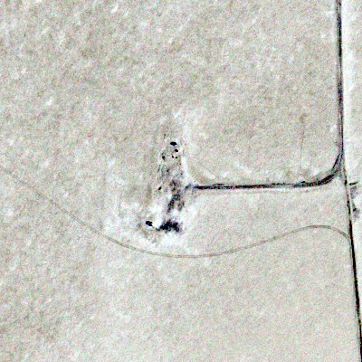
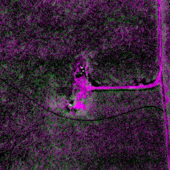
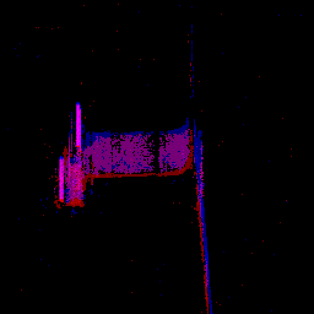

Gallery
=======================================

The Railroad Valley Playa scene (:doc:`tools`) on 2022-07-19, at Sentinel-2B's pass (the sun at a zenith of 26.25°), seen at nadir from 500 km by a ``satellite_frame`` camera of 2.5 m focal length, in four bands (blue 450–520, green 520–600, red 630–690, near infrared 760–900 nm), and imaged by the example instruments.
Rendered on the GPU (an NVIDIA GB10, CUDA + OptiX build, ray tracing) at ``f565eed``; times as the command line reports them (``Elapsed``, without loading the scene's 2.16 M triangles, ~40 s).
The images (but the events') are previews of the EXR outputs, made with ``preview.py``: values mapped linearly from the range given (by default from percentiles of the values), then sRGB-encoded.
Where a preview is binned, cropped or zoomed, its caption links to a JPEG of the whole image at full resolution, made the same way.

.. list-table::
   :header-rows: 1
   :widths: 30 32 14 12

   * - Scene
     - Film
     - Samples
     - Time
   * - ``scene.xml``
     - 1920², 1 m GSD, 5 µm pixels
     - 8192
     - 4 min 58 s
   * - ``noatm.xml`` (``--no-atmosphere``)
     - 1920², 1 m GSD, 5 µm pixels
     - 8192
     - 3 min 21 s
   * - ``scene_k4.xml``
     - 4096², 0.25 m GSD, 1.25 µm pixels
     - 1024
     - 2 min 32 s

The scenes were built and rendered with the commands of :doc:`tools` (``build_scene.py sites/railroad_valley --name noatm --no-atmosphere`` for ``noatm.xml``), with ``-D spp=8192`` (``-D spp=1024`` for ``scene_k4.xml``), then, from the repository's root, for example:

.. code-block:: sh

   P="uv run tools/remote_sensing/preview.py"
   $P out/toa.exr toa_rgb.jpg --bin 3 --per-band --percentiles 0.1,99.9
   $P out/toa.exr toa_cir.jpg --bands nir,red,green --bin 3 --per-band --percentiles 0.1,99.9
   $P out/toa.exr toa_facility.jpg --crop 640,720,400,400 --per-band
   $P out_noatm/camera.exr surface_blue.jpg --bands blue --crop 640,720,400,400 --range 142,166
   $P out/toa.exr toa_blue.jpg --bands blue --crop 640,720,400,400 --range 142,166
   $P sites/railroad_valley/materials.exr materials.jpg --bands B,G,B --crop 1173,1307,666,666 --bin 2 --range 0,0.3
   $P out_k4/dn.exr detector_frame.jpg --crop 256,352,256,256 --zoom 2 --per-band

Top-of-atmosphere radiance
--------------------------

``toa.py``'s output: the render plus the path radiance and the adjacency effect.
Its mean radiances are 161.0, 186.4, 196.3 and 145.2 W/m²/sr/µm (blue, green, red, near infrared), of which the render is 114.1, 156.4, 178.5 and 137.8, the path radiance 31.8, 16.2, 7.3 and 2.3, and the adjacency effect 15.1, 13.8, 10.5 and 5.1.
The playa fills almost all of the 1920 m: the facility near its centre (roads, structures) is the most contrast the scene has, so each band is stretched over its own 0.1–99.9th percentiles.

.. grid:: 1 2 2 2
   :gutter: 2

   .. grid-item-card:: True colour (red, green, blue)
      :img-top: ../_static/remote_sensing/toa_rgb.jpg

      1920 m, binned 3 × 3. `Full resolution (1920², 1.7 MB) <../_static/remote_sensing/full/rrv_toa_rgb.jpg>`__.

   .. grid-item-card:: Colour infrared (near infrared, red, green)
      :img-top: ../_static/remote_sensing/toa_cir.jpg

      1920 m, binned 3 × 3. `Full resolution (1920², 1.8 MB) <../_static/remote_sensing/full/rrv_toa_cir.jpg>`__.

   The facility, 400 m at full resolution (1 m), each band stretched over its 0.5–99.5th percentiles.

.. grid:: 1 2 2 2
   :gutter: 2

   .. grid-item-card:: Surface radiance, blue
      :img-top: ../_static/remote_sensing/surface_blue.jpg

      ``noatm.xml``: the ground under the top-of-atmosphere sun, without an atmosphere. 142–166 W/m²/sr/µm. `Full resolution (1920², 1.3 MB) <../_static/remote_sensing/full/rrv_surface_blue.jpg>`__.

   .. grid-item-card:: Top-of-atmosphere radiance, blue
      :img-top: ../_static/remote_sensing/toa_blue.jpg

      ``scene.xml`` and ``toa.py``, on the same scale: the atmosphere attenuates the ground's contrast, the path radiance offsets it, and the adjacency effect blurs it. `Full resolution (1920², 0.9 MB) <../_static/remote_sensing/full/rrv_toa_blue.jpg>`__.

Materials
---------

   ``materials.py``'s abundances over the facility (``materials.exr``, on NAIP's 0.6 m grid, binned 2 × 2; 0–0.3): concrete green, asphalt magenta.
   The playa (99.1% of the site's mean abundance) is not shown.

Detectors
---------

``scene_k4.xml``'s top-of-atmosphere radiance (4 × 4 render pixels per detector pixel) imaged by ``detector.py`` onto 5 µm pixels (1 m GSD), 256 m of the facility, zoomed 2 ×.
Each band is stretched over its own percentiles.

.. grid:: 1 3 3 3
   :gutter: 2

   .. grid-item-card:: Radiance
      :img-top: ../_static/remote_sensing/detector_ideal.jpg

      ``toa.py``'s output, binned to the detector's pixels: no blur, no noise. `Full resolution (the 4096² render, 9.4 MB) <../_static/remote_sensing/full/rrv_k4_toa_rgb.jpg>`__.

   .. grid-item-card:: Frame camera
      :img-top: ../_static/remote_sensing/detector_frame.jpg

      ``instrument.json``: 0.4 m telescope, 0.1 ms exposure; 551–1238 electrons, SNR 23–35. `Full resolution (1024², 0.7 MB) <../_static/remote_sensing/full/rrv_detector_frame.jpg>`__.

   .. grid-item-card:: TDI camera
      :img-top: ../_static/remote_sensing/detector_tdi.jpg

      ``instrument_tdi.json``: 16 stages, 141.6 µs lines, 100 Hz jitter; 1.2–2.8 × 10⁴ electrons, SNR 110–166. `Full resolution (1024², 0.6 MB) <../_static/remote_sensing/full/rrv_detector_tdi.jpg>`__.

   ``event_camera.py``: 10 ms of an event camera of 10 µm pixels (2 m GSD) scanning at the orbit's ground speed, with thresholds of 0.03 (``event_camera.json``'s are 0.25, which the scene's contrast at 2 m never reaches).
   10 830 events (5061 ON, 5769 OFF), 354 time steps, in 45 s; their counts per pixel over 512 m around the facility, ON red, OFF blue (square root of the counts, zoomed 2 ×).

Towns and cities
----------------

Five sites built by the town workflow of :doc:`tools` (``fetch_site.py --lidar --sentinel2``, ``materials.py --classes``, ``atmosphere.py`` with 6S, ``build_scene.py``), each 2048 m on a side around the given centre and seen at nadir at the Sentinel-2 pass whose surface reflectance calibrated NAIP.
Each scene is a 2048² vertex surface model from the lidar (a 1 m grid: 8.38 M triangles, split by lidar class into ground, grass, tree, building, water and wall meshes, plus a 64 k triangle sky), with each class's material a per-pixel mix of four library spectra unmixed from calibrated NAIP.
Rendered on the GPU (NVIDIA GB10, CUDA + OptiX) at 1920², 1 m GSD, 64 samples per pixel, with beams and without forward scattering detection (``--fsd`` is off for surface models); times are the command line's ``Elapsed``, which excludes loading the scene (10–20 s).
The images are ``toa.py``'s top-of-atmosphere radiance (render + path radiance + adjacency effect), each band stretched over its own 0.1–99.9th percentiles: the whole 1920 m binned 3 × 3, and a 640 m window at full resolution.

.. list-table:: Input data
   :header-rows: 1
   :widths: 16 21 27 18 18

   * - Site (centre)
     - Bare-earth DEM (3DEP 1 m)
     - Lidar (3DEP)
     - NAIP
     - Sentinel-2 L2A (calibration r²: red, green, blue, nir)
   * - Goddard Space Flight Center, Greenbelt MD (38.9925, −76.8398)
     - ``MD_Central_Processing_D24``
     - ``MD_VA_Sandy_NCR_2014``: 19.1 M returns, 4.6 /m², highest 45.5 m
     - 2023-09-01, 0.3 m
     - S2A, 2023-09-02 15:48 UTC (0.81, 0.78, 0.83, 0.46)
   * - UMBC, Catonsville MD (39.2546, −76.7094)
     - ``MD_4County_D24``
     - ``MD_4County_2_D24`` (LAZ tiles): 64.2 M returns, 15.3 /m², highest 113 m
     - 2023-05-25, 0.3 m
     - S2A, 2023-05-25 15:49 UTC (0.86, 0.84, 0.88, 0.71)
   * - Downtown Reno NV (39.533, −119.814)
     - ``NV_USFSR4_D23``
     - ``NV_Reno_Carson_QL1_2017``: 38.6 M returns, 9.2 /m², highest 70.6 m
     - 2022-06-14, 0.6 m
     - S2B, 2022-06-15 18:39 UTC (0.71, 0.71, 0.74, 0.54)
   * - Downtown Fresno CA (36.7378, −119.7871)
     - ``CA_SanJoaquin_2021_A21``
     - ``CA_SanJoaquin_3_2021``: 79.9 M returns, 19 /m², highest 106 m
     - 2022-06-20, 0.6 m
     - S2B, 2022-06-25 18:39 UTC (0.48, 0.49, 0.54, 0.42)
   * - Midtown Manhattan NY (40.754, −73.984)
     - ``NY_CMPG_2013``
     - ``NY_NewYorkCity``: 18.8 M returns, 4.5 /m², highest 431 m
     - 2022-07-19 (and 2022-07-10, New Jersey), 0.6 m
     - S2A, 2022-07-19 15:49 UTC (0.22, 0.22, 0.23, 0.27)

.. list-table:: Conditions and surface
   :header-rows: 1
   :widths: 16 26 10 24 24

   * - Site
     - AERONET site (distance): AOT at 550 nm, water vapour
     - Sun zenith
     - Lidar classes (ground, grass, tree, building, water)
     - Relief of the surface model
   * - Goddard
     - GSFC (0 km): 0.073, 1.9 cm
     - 35.8°
     - 7, 45, 44, 4, 0%
     - −25 .. 55 m
   * - UMBC
     - MD_Science_Center (8.9 km): 0.130, 0.92 cm
     - 24.2°
     - 10.5, 48.8, 36.5, 4.1, 0.1%
     - −37 .. 144 m
   * - Reno
     - Univ_of_Nevada-Reno (0.9 km): 0.036, 0.75 cm
     - 23.5°
     - 51.5, 7.7, 12.6, 27.0, 1.2%
     - −12 .. 72 m
   * - Fresno
     - Fresno_2 (5.4 km): 0.075, 1.7 cm
     - 22.2°
     - 56.7, 6.6, 8.0, 28.6, 0%
     - −10 .. 104 m
   * - Manhattan
     - CCNY (8 km): 0.148, 2.8 cm
     - 25.2°
     - 34.2, 1.4, 2.0, 62.4, 0%
     - −25 .. 425 m

The sites differ in what limits them.
Goddard's lidar is from 2014, nine years before its NAIP, and buildings are 4% of the site: it is mostly lawns and forest.
UMBC's lidar is the densest of the five (15 returns/m²) and its NAIP was flown on the day of its Sentinel-2 pass, so its calibration fits best.
Reno's lidar is from 2017 and Fresno's from 2021; both have NAIP and Sentinel-2 within days of one another.
Fresno's calibration fits worse than Reno's (r² ≈ 0.5 against 0.7), as does Goddard's in the near infrared, likely because NAIP and Sentinel-2 see the surface at different times of day and from different angles.
Manhattan's fits worst: NAIP's off-nadir views lean its towers over the streets (relief displacement) and its shadows are long, so the NAIP and lidar pixels of a building disagree, and a quarter of the surface model's triangles are walls.

.. list-table:: Renders (radiances in W/m²/sr/µm: blue, green, red, nir)
   :header-rows: 1
   :widths: 16 28 12 22 22

   * - Site
     - Surface model's triangles by class (ground, grass, tree, building, water, wall)
     - Time (``Elapsed``)
     - Mean top-of-atmosphere radiance
     - Path radiance
   * - Goddard
     - 6.7, 45.1, 43.9, 3.6, 0, 0.7%
     - 3 min 31 s
     - 51.8, 38.7, 26.4, 42.7
     - 35.1, 17.9, 8.1, 2.5
   * - UMBC
     - 10.2, 48.8, 36.5, 3.5, 0.1, 0.9%
     - 2 min 27 s
     - 63.7, 52.3, 37.3, 74.2
     - 40.6, 21.3, 10.0, 3.4
   * - Reno
     - 47.4, 7.7, 12.5, 21.5, 1.1, 9.8%
     - 1 min 45 s
     - 90.2, 80.1, 67.7, 61.4
     - 32.0, 16.1, 7.1, 2.1
   * - Fresno
     - 52.9, 6.6, 8.0, 23.9, 0, 8.5%
     - 1 min 35 s
     - 95.5, 82.7, 70.2, 57.2
     - 38.7, 19.9, 9.0, 2.9
   * - Manhattan
     - 29.4, 1.4, 2.0, 41.5, 0, 25.7%
     - 3 min 15 s
     - 64.6, 47.1, 35.2, 22.9
     - 40.8, 21.6, 10.3, 3.5

.. grid:: 1 2 2 2
   :gutter: 2

   .. grid-item-card:: Goddard Space Flight Center
      :img-top: ../_static/remote_sensing/city_gsfc.jpg

      1920 m, binned 3 × 3. `Full resolution (1920², 1.8 MB) <../_static/remote_sensing/full/city_gsfc.jpg>`__.

   .. grid-item-card:: Goddard, 640 m at 1 m
      :img-top: ../_static/remote_sensing/city_gsfc_crop.jpg

      The campus's buildings among lawns and trees (``--crop 760,560,640,640``).

   .. grid-item-card:: UMBC
      :img-top: ../_static/remote_sensing/city_umbc.jpg

      1920 m, binned 3 × 3. `Full resolution (1920², 1.8 MB) <../_static/remote_sensing/full/city_umbc.jpg>`__.

   .. grid-item-card:: UMBC, 640 m at 1 m
      :img-top: ../_static/remote_sensing/city_umbc_crop.jpg

      The campus core: its quad and paths, the library and academic buildings, and parking lots along the loop road (``--crop 640,640,640,640``).

   .. grid-item-card:: Reno
      :img-top: ../_static/remote_sensing/city_reno.jpg

      1920 m, binned 3 × 3. `Full resolution (1920², 1.7 MB) <../_static/remote_sensing/full/city_reno.jpg>`__.

   .. grid-item-card:: Reno, 640 m at 1 m
      :img-top: ../_static/remote_sensing/city_reno_crop.jpg

      Downtown's casino blocks (``--crop 560,1000,640,640``).

   .. grid-item-card:: Fresno
      :img-top: ../_static/remote_sensing/city_fresno.jpg

      1920 m, binned 3 × 3. `Full resolution (1920², 1.7 MB) <../_static/remote_sensing/full/city_fresno.jpg>`__.

   .. grid-item-card:: Fresno, 640 m at 1 m
      :img-top: ../_static/remote_sensing/city_fresno_crop.jpg

      Downtown, its street trees and the buildings' shadows (``--crop 640,640,640,640``).

   .. grid-item-card:: Manhattan
      :img-top: ../_static/remote_sensing/city_manhattan.jpg

      1920 m, binned 3 × 3. `Full resolution (1920², 2.1 MB) <../_static/remote_sensing/full/city_manhattan.jpg>`__.

   .. grid-item-card:: Manhattan, 640 m at 1 m
      :img-top: ../_static/remote_sensing/city_manhattan_crop.jpg

      Bryant Park and the New York Public Library, with Times Square at the top left (``--crop 600,480,640,640``).

What went into Reno's 640 m window: NAIP (true colour), the lidar surface model (shaded relief, tinted by height) and its classes (ground grey, grass light green, tree dark green, building red, water blue; walls are the steep triangles between classes, not a class of the grid).

.. grid:: 1 3 3 3
   :gutter: 2

   .. grid-item-card:: NAIP, 2022-06-14
      :img-top: ../_static/remote_sensing/city_reno_naip.jpg

   .. grid-item-card:: Lidar surface model
      :img-top: ../_static/remote_sensing/city_reno_dsm.jpg

   .. grid-item-card:: Lidar classes
      :img-top: ../_static/remote_sensing/city_reno_classes.jpg

Manhattan at 8192²
~~~~~~~~~~~~~~~~~~

Renders are not limited to 1920².
``manhattan_4k`` is 4096 m on a side around the same centre, from the Hudson to the East River and from Union Square to Central Park, built the same way and rendered at 8192², 0.5 m GSD, 64 samples per pixel.

.. code-block:: sh

   uv run tools/remote_sensing/fetch_site.py sites/manhattan_4k --lat 40.754 --lon -73.984 --size 4096 \
       --date 2022-07-19 --lidar --sentinel2
   python tools/remote_sensing/atmosphere.py sites/manhattan_4k --time 2022-07-19T15:49:51Z
   uv run tools/remote_sensing/materials.py sites/manhattan_4k
   uv run tools/remote_sensing/build_scene.py sites/manhattan_4k --time 2022-07-19T15:49:51Z --pixels 8192 --gsd 0.5
   ./build/wave_tracer render --gpu sites/manhattan_4k/scene.xml -o out_m4k -D spp=64
   uv run tools/remote_sensing/toa.py sites/manhattan_4k/scene.json out_m4k/camera.exr out_m4k/toa.exr

.. list-table::
   :widths: 40 60

   * - Lidar (3DEP ``NY_NewYorkCity``)
     - 78.8 M returns, 4.7 /m², highest 431 m
   * - Calibration r² (red, green, blue, nir)
     - 0.40, 0.39, 0.48, 0.44
   * - Lidar classes (ground, grass, tree, building, water)
     - 28.3, 5.5, 7.5, 43.7, 15.0%
   * - Surface model's triangles by class (ground, grass, tree, building, water, wall)
     - 33.5 M: 24.6, 5.5, 7.5, 30.0, 14.8, 17.4%
   * - Time: fetching, ``materials.py``, loading the scene, rendering (``Elapsed``)
     - about 6 min, 7 min and 1 min; 50 min 50 s
   * - Peak memory of the render
     - 36.8 GB
   * - Mean top-of-atmosphere radiance (blue, green, red, nir)
     - 69.7, 53.1, 40.1, 28.4 W/m²/sr/µm

Most of the rivers' lidar returns are unclassified (4.6% of the site's cells are classed water), but ``materials.py``'s water rule (:doc:`tools`, step 2) makes the Hudson and the East River water: 15% of the site.
The rivers are about as bright as the city in the visible, as Sentinel-2 sees them: relative to the site's mean, 0.92–1.20 in the render's visible bands and 0.68–0.77 in the near infrared, against Sentinel-2's 0.84–1.01 and 0.51–0.60.
The input data limit the detail: the surface model is a 1 m grid and NAIP 0.6 m, so a finer GSD only resamples them.

.. grid:: 1 2 2 2
   :gutter: 2

   .. grid-item-card:: Manhattan, 4096 m
      :img-top: ../_static/remote_sensing/city_manhattan_4k.jpg

      8192², binned 13 × 13. `Full resolution (8192², 32 MB) <../_static/remote_sensing/full/city_manhattan_4k.jpg>`__.

   .. grid-item-card:: 320 m at 0.5 m
      :img-top: ../_static/remote_sensing/city_manhattan_4k_crop.jpg

      Bryant Park's lawn and plane trees, with the New York Public Library at the lower right (``--crop 3776,3776,640,640``).
